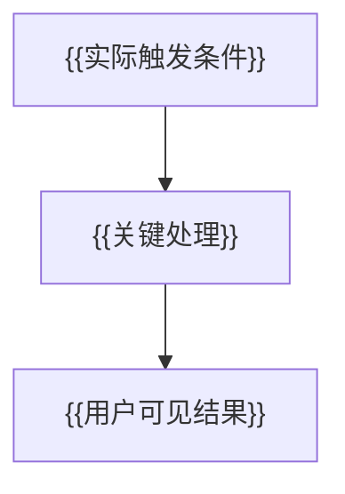
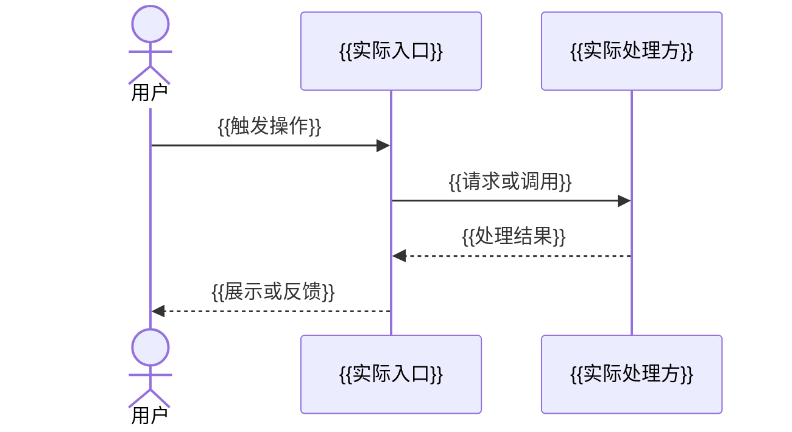

# 第二步：明确目标并取得开发同意

## 需求理解

{{用一两句话说明要解决什么问题，以及完成后用户会看到什么变化。}}

## 目标

- {{本次要实现的结果，以及判断完成的具体标准。}}

## 非目标

- {{本次不做的内容和明确的边界。}}

## 实施方案

{{用通俗语言说明怎么实现、复用哪些现有能力；必要时解释关键取舍。}}

## 改动文件范围

| 操作 | 文件路径 | 改动内容及原因 |
| --- | --- | --- |
| {{新增 / 修改 / 删除}} | `{{具体路径}}` | {{说明该文件为什么需要改。}} |

## 方案流程图

## 方案时序图

## 影响与待确认项

- 影响与限制：{{数据、接口兼容性、现有功能受到的影响；没有则写“无”。}}
- 待确认项：{{尚未明确的内容及影响；没有则写“无”。}}

## 建议测试安排（尚未授权）

- 测试内容与方式：{{建议覆盖的场景和执行方式。}}
- 时间或环境影响：{{预计耗时、环境要求；不确定时如实说明。}}
- 测试问题报告路径：`{{沿用项目约定或建议的具体路径}}`（有未通过用例时生成）。

## 请确认

是否同意以上目标、方案和文件范围，并进入第三步开始开发？测试将于开发完成后单独征求意见。
